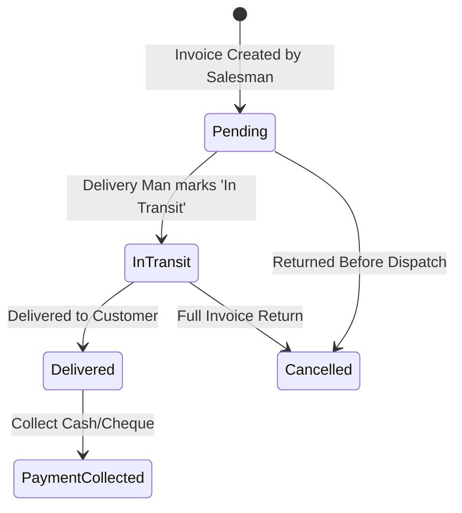

# Hardmen Enterprise Management System — Comprehensive Operations & QA Manual

---

## 📑 Table of Contents
1. [System Architecture & Role-Based Access Control (RBAC)](#1-system-architecture--rbac)
2. [Core Financial & Inventory Engines](#2-core-financial--inventory-engines)
   - [FIFO Inventory Costing & Deduction Engine](#fifo-inventory-costing--deduction-engine)
   - [Customer Balance & Chronological Ledger Reconciliation Engine](#customer-balance--chronological-ledger-reconciliation-engine)
   - [Product Variant Management System](#product-variant-management-system)
3. [Module-by-Module Functional Guide & Test Cases](#3-module-by-module-functional-guide--test-cases)
   - [3.1 POS / Store Billing & Session Management](#31-pos--store-billing--session-management)
   - [3.2 Salesman Mobile Portal](#32-salesman-mobile-portal)
   - [3.3 Delivery Man Portal](#33-delivery-man-portal)
   - [3.4 Customer Management & Real-Time Ledger](#34-customer-management--real-time-ledger)
   - [3.5 Product & Variant Catalog](#35-product--variant-catalog)
   - [3.6 Purchasing, GRN & Supplier Management](#36-purchasing-grn--supplier-management)
   - [3.7 Cheque & Bank Clearance Management](#37-cheque--bank-clearance-management)
   - [3.8 Staff Allocations & Inventory Tracking](#38-staff-allocations--inventory-tracking)
   - [3.9 Quotation System](#39-quotation-system)
   - [3.10 Accounting, Day Summary, Expenses & Profit/Loss](#310-accounting-day-summary-expenses--profitloss)
4. [QA Testing Workflows & Edge-Case Validation Checklist](#4-qa-testing-workflows--edge-case-validation-checklist)

---

## 1. System Architecture & RBAC

The system enforces role-based routing and granular permissions across 5 distinct user roles:

```mermaid
graph TD
    User([User Login]) --> Authenticate{Role / Staff Type}
    Authenticate -->|Role: Admin| AdminApp[Admin Portal /admin/*]
    Authenticate -->|Role: Staff + salesman| SalesmanApp[Salesman Portal /salesman/*]
    Authenticate -->|Role: Staff + delivery_man| DeliveryApp[Delivery Portal /delivery/*]
    Authenticate -->|Role: Staff + shop_staff| ShopStaffApp[Shop Staff Portal /shop-staff/*]
    Authenticate -->|Role: Staff (General)| GeneralStaffApp[Staff Portal /staff/*]
```

### Role Matrix & Responsibilities

| Role | Access URL Prefix | Primary Responsibilities |
| :--- | :--- | :--- |
| **Admin** | `/admin/*` | Complete system access: POS, inventory, supplier purchases, cash sessions, finance, profit/loss, ledger audits. |
| **Salesman** | `/salesman/*` | Taking field orders for distributors/retailers, checking customer dues, applying overpaid credits, mobile order tracking. |
| **Delivery Man** | `/delivery/*` | In-transit dispatch, delivery confirmation, customer cash/cheque collection at doorstep, item/full invoice returns. |
| **Shop Staff** | `/shop-staff/*` | In-store counter operations, store stock lookup. |
| **General Staff** | `/staff/*` | Staff-assigned billing, allocated product sales, quotations. |

---

## 2. Core Financial & Inventory Engines

### FIFO Inventory Costing & Deduction Engine
* **Algorithm**: First-In, First-Out (`FIFOStockService`).
* **Purchase Batches**: Every GRN (Goods Receive Note) creates a stock batch with purchase unit cost.
* **Sale Deduction**: When an invoice is confirmed, stock is deducted from the oldest available purchase batches. If a sale spans multiple batches with differing unit costs, profit & loss correctly calculates multi-tier cost of goods sold (COGS).
* **Return Restoration**: When an invoice is returned, items are returned to available stock and restored in inventory.

### Customer Balance & Chronological Ledger Reconciliation Engine
The customer ledger guarantees that:
$$\text{Total Customer Due} = (\text{Opening Balance} - \text{Opening Balance Paid}) + \text{Unpaid Invoices Due} + \text{Returned Cheques} - \text{Overpaid Credits}$$

* **Payments Allocation**: All payments are allocated chronologically:
  1. First to unpaid Opening Balance.
  2. Then to oldest unpaid Invoices.
  3. Any excess payment automatically becomes **`overpaid_amount`** (credit advance).
* **Automatic Credit Offsetting**: When a new invoice is created or edited for a customer with an overpaid balance, the credit is automatically deducted first, and only the remainder becomes due.
* **Central Sync Service**: Handled by `\App\Services\CustomerBalanceService::syncCustomerBalance($customerId)` to eliminate data desynchronization across all pages.

---

## 3. Module-by-Module Functional Guide & Test Cases

### 3.1 POS / Store Billing & Session Management
* **Routes**: `/admin/store-billing`, `/staff/store-billing`

#### Key Functions:
1. **Cash Register Sessions**:
   - Cashiers open a session with opening cash amount.
   - All cash sales and collections update register cash in real-time.
   - At end of day, cashier closes session with denomination breakdown. Admins can reopen closed sessions if corrections are needed (`/reopen-pos-session`).
2. **Pricing Tiers**:
   - `Retail Price`: Standard store pricing.
   - `Wholesale Price`: Discounted bulk pricing.
   - `Distribute Price`: Special distributor pricing (falls back to wholesale if not explicitly configured).
3. **Counter Delivery**:
   - Store POS sales automatically have `delivery_status = 'delivered'` because items are handed over immediately.
4. **Discounts**:
   - Item-level fixed/percentage discounts.
   - Bill-level additional discount (percentage or fixed amount).

---

### 3.2 Salesman Mobile Portal
* **Routes**: `/salesman/dashboard`, `/salesman/billing`, `/salesman/sales`, `/salesman/customer-dues`

#### Key Functions:
1. **Field Invoicing**:
   - Fast customer lookup with automatic price tier selection (Retail / Wholesale / Distribute).
   - Real-time stock availability check.
   - Automatic deduction of customer overpaid credits.
2. **Delivery Status Initiation**:
   - Orders created by Salesmen default to `delivery_status = 'pending'`, placing them into the delivery dispatch queue.
3. **Customer Dues Tracking**:
   - View outstanding customer debts, overdue invoices, and previous payment histories before booking new orders.

---

### 3.3 Delivery Man Portal
* **Routes**: `/delivery/pending`, `/delivery/completed`, `/delivery/payments`, `/delivery/return-product`



#### Key Functions:
1. **Pending Deliveries (`/delivery/pending`)**:
   - Shows all confirmed invoices with `delivery_status = 'pending'`.
   - Action **"Start Transit"**: Sets `delivery_status = 'in_transit'` and assigns to delivery staff.
   - Action **"Mark Delivered"**: Sets `delivery_status = 'delivered'`, sets `delivered_at` timestamp.
2. **Doorstep Payment Collection (`/delivery/payments`)**:
   - Collect Cash or Cheque for delivered invoices with pending dues.
   - Overpayments automatically update customer overpaid credits.
3. **Product & Invoice Returns (`/delivery/return-product`)**:
   - **Partial Return**: Return specific defective/unwanted quantities. Stock is restored, and customer balance is automatically synchronized.
   - **Full Invoice Return**: Cancels the invoice (`delivery_status = 'cancelled'`), restores 100% of stock, and clears all dues.

---

### 3.4 Customer Management & Real-Time Ledger
* **Routes**: `/admin/manage-customer`, `/staff/manage-customers`

#### Key Functions:
1. **Customer Profile & Limits**:
   - Name, business name, phone, address, customer type, opening balance.
2. **Ledger Tab (`/admin/manage-customer` -> View Details -> Ledger)**:
   - Chronological statement of all debits (invoices, returned cheques) and credits (cash, cheques, product returns, discounts).
   - Running balance indicator (**Dr** = Customer owes money, **Cr** = Customer has advance credit).
3. **Automated Reconciliation**:
   - Real-time synchronization via `CustomerBalanceService`.

---

### 3.5 Product & Variant Catalog
* **Routes**: `/admin/Product-list`, `/admin/manage-variants`, `/admin/update-price`

#### Key Functions:
1. **Dynamic Variant Schema**:
   - Support for multiple attributes: Brand, Category, Type, Dial Color, Strap Material, Strap Color, Glass Type.
   - Stored in JSON variant records with dedicated SKU/barcode tracking.
2. **Tiered Pricing Structure**:
   - Buy Price (Cost), Retail Price, Wholesale Price, Distributor Price.
3. **Stock Auditing**:
   - Available stock, damage stock, sold count, batch-level reorder alerts.

---

### 3.6 Purchasing, GRN & Supplier Management
* **Routes**: `/admin/goods-receive-note`, `/admin/purchase-order-list`, `/admin/supplier-management`

#### Key Functions:
1. **Purchase Orders (PO) & GRN**:
   - Create PO for suppliers with expected costs.
   - Receive Goods: Creates FIFO purchase batch records with exact unit costs.
2. **Supplier Payments & Returns**:
   - Track supplier debts, pay via cash/cheque/bank transfer.
   - Supplier Returns: Return damaged/excess inventory, deducting supplier balance.

---

### 3.7 Cheque & Bank Clearance Management
* **Routes**: `/admin/cheque-list`, `/admin/return-cheque`

#### Key Functions:
1. **Cheque Lifecycle**:
   - `Pending` $\rightarrow$ `Deposited` $\rightarrow$ `Complete` (Cleared) or `Return` (Bounced).
2. **Bounced Cheque Handling**:
   - Marking a cheque as `Return` automatically adds the cheque amount back as a debit to customer `total_due`.

---

### 3.8 Staff Allocations & Inventory Tracking
* **Routes**: `/admin/staff-product-allocation`, `/admin/staff-allocated-list`, `/admin/staff-product-reentry/{staffId}`

#### Key Functions:
1. **Stock Allocation**:
   - Issue warehouse products to specific staff members for field vanity vans/sales.
2. **Staff Stock Re-entry**:
   - Return unsold staff stock back to main warehouse inventory without data corruption.

---

### 3.9 Quotation System
* **Routes**: `/admin/quotation-system`, `/admin/quotation-list`

#### Key Functions:
1. **Quotation Generation**:
   - Generate quotations with validity dates and custom discount structures.
2. **One-Click Invoice Conversion**:
   - Convert approved quotation directly to a confirmed Sale invoice, immediately executing FIFO stock deduction.

---

### 3.10 Accounting, Day Summary, Expenses & Profit/Loss
* **Routes**: `/admin/profit-loss`, `/admin/expenses`, `/admin/day-summary`, `/admin/reports`

#### Key Functions:
1. **Real-Time Profit & Loss (`/admin/profit-loss`)**:
   $$\text{Gross Profit} = \text{Revenue (Net Sales)} - \text{COGS (FIFO Batch Cost)}$$
   $$\text{Net Profit} = \text{Gross Profit} - \text{Expenses}$$
2. **Expense Tracking**:
   - Categorized operating expenses (Rent, Fuel, Salaries, Maintenance).
3. **Day Summary Report**:
   - Daily breakdown of Total Cash Sales, Cheque Collections, Credit Sales, Dues Collected, and Cash-in-hand reconciliation.

---

## 4. QA Testing Workflows & Edge-Case Validation Checklist

### Test Scenario Matrix

| ID | Test Scenario | Steps to Execute | Expected Result |
| :--- | :--- | :--- | :--- |
| **TS-01** | **POS Counter Sale** | 1. Go to `/admin/store-billing`<br>2. Select customer, choose `Distribute Price`<br>3. Add items and complete full cash payment. | Sale is confirmed with `delivery_status = 'delivered'`. Stock deducted via FIFO. Session cash increases. |
| **TS-02** | **Salesman Order to Delivery** | 1. Go to `/salesman/billing`<br>2. Create credit order for customer<br>3. Switch to Delivery Man login at `/delivery/pending`<br>4. Mark "In Transit" then "Delivered". | Sale starts with `pending`, moves to `in_transit`, then `delivered`. Customer due increases by bill total. |
| **TS-03** | **Product Return with Credit Balance** | 1. In Delivery Man portal, open `/delivery/return-product`<br>2. Process partial return on paid invoice. | Return is recorded, stock is restored, and customer receives `overpaid_amount` credit equal to returned goods value. |
| **TS-04** | **Overpaid Credit Auto-Deduction** | 1. Select customer with `overpaid_amount > 0` in `/salesman/billing`<br>2. Create new invoice larger than overpaid amount. | System automatically consumes 100% of overpaid credit. Only the remainder is marked as `due_amount`. Overpaid becomes `0.00`. |
| **TS-05** | **Cheque Bounce Rebound** | 1. In `/admin/cheque-list`, change a cleared/pending cheque to `return`. | Cheque status changes to `return`. Customer `total_due` immediately increases by bounced cheque amount on ledger. |
| **TS-06** | **FIFO Multi-Tier Costing** | 1. Receive 10 units @ Rs. 100 via GRN<br>2. Receive 10 units @ Rs. 120 via GRN<br>3. Sell 15 units @ Rs. 150. | First 10 units cost @ Rs. 100, next 5 cost @ Rs. 120. Total COGS = Rs. 1,600. Gross Profit = Rs. 650. |
| **TS-07** | **Customer Ledger Audit Sync** | 1. Run `php artisan customer:recalculate-dues`<br>2. View Customer Ledger in `/admin/manage-customer`. | Total Debits minus Total Credits equals Customer Total Due. No discrepancy across any tab. |
